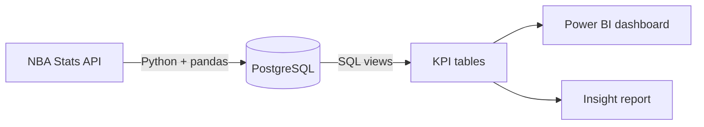

# 🏀 Triple Double: NBA Performance Analytics

**A business analytics project that turns NBA game data into KPIs, a Power BI dashboard, and recommendations a team's front office could act on.**


> 🚧 **Status: in progress.** See [Roadmap](#roadmap) for what is done and what is next.

---

## The Business Problem

NBA front offices and coaching staff make decisions every week about player minutes, rest days, and roster moves. Box score data is freely available, but it is scattered across thousands of games and hard to turn into clear answers.

This project acts as an analyst supporting a team's front office. It answers a short list of decision-focused questions with data and presents the answers in a dashboard and a short report.

## Stakeholders & Business Questions

| Stakeholder | Question | Why it matters |
|---|---|---|
| Coaching staff | Does performance drop on the second night of a back-to-back? | Informs rest and minutes decisions |
| Coaching staff | Which players are trending up or down over their last 10 games? | Informs rotation decisions |
| Front office | Which teams win more (or less) than their stats suggest? | Spots over- and under-performing teams |
| Front office | Which players produce the most per minute played? | Helps find undervalued role players |
| Analytics team | How do home and away results differ by team? | Identifies scheduling and travel effects |

The full requirements, including user stories and KPI definitions, are in [`docs/requirements.md`](docs/requirements.md).

## KPIs

| KPI | Definition |
|---|---|
| Net Rating | Points scored minus points allowed per 100 possessions |
| True Shooting % | Shooting efficiency including 3-pointers and free throws |
| Rolling Form | A player's average game score over his last 10 games vs. his season average |
| Back-to-Back Impact | Change in team net rating on the second night of back-to-backs |
| Home/Away Split | Win % at home minus win % on the road |

## Deliverables

1. **Power BI dashboard** with team overview, player form tracker and back-to-back analysis pages
2. **Insight report** (2 pages) with key findings and recommendations for coaching staff and the front office
3. **Requirements document** covering stakeholders, user stories, KPI definitions and acceptance criteria

<!--  -->

## Key Insights

_Coming soon. Findings will be added here once the analysis is complete._

## How It Works



1. A Python script pulls game, team and player box scores using `nba_api`
2. pandas cleans the data (missing values, duplicate games, team name changes)
3. Data is loaded into PostgreSQL
4. SQL views calculate each KPI
5. Power BI connects to the views for the dashboard

## Tech Stack

| Purpose | Tool |
|---|---|
| Data collection | Python, `nba_api` |
| Cleaning | pandas |
| Storage | PostgreSQL |
| Analysis | SQL |
| Dashboard | Power BI |
| Report | Excel, Word/PDF |

## Project Structure

```
triple-double/
├── ingestion/        # Python scripts to fetch and clean data
├── sql/              # SQL views for each KPI
├── powerbi/          # Power BI dashboard (.pbix)
├── docs/
│   ├── requirements.md
│   ├── insights_report.pdf
│   └── dashboard.png
└── README.md
```

## Getting Started

```bash
git clone https://github.com/BenNguyen0204/NBAData.git
cd NBAData
pip install -r requirements.txt
python ingestion/load_games.py --season 2025-26
```

Then open `powerbi/triple_double.pbix` in Power BI Desktop and refresh the data source.

## Roadmap

- [ ] Write requirements document (stakeholders, user stories, KPIs)
- [ ] Ingest 2025-26 season data into PostgreSQL
- [ ] Build SQL views for each KPI
- [ ] Build Power BI dashboard
- [ ] Write insight report with recommendations
- [ ] Add automated daily data refresh
- [ ] Add data quality checks with dbt
